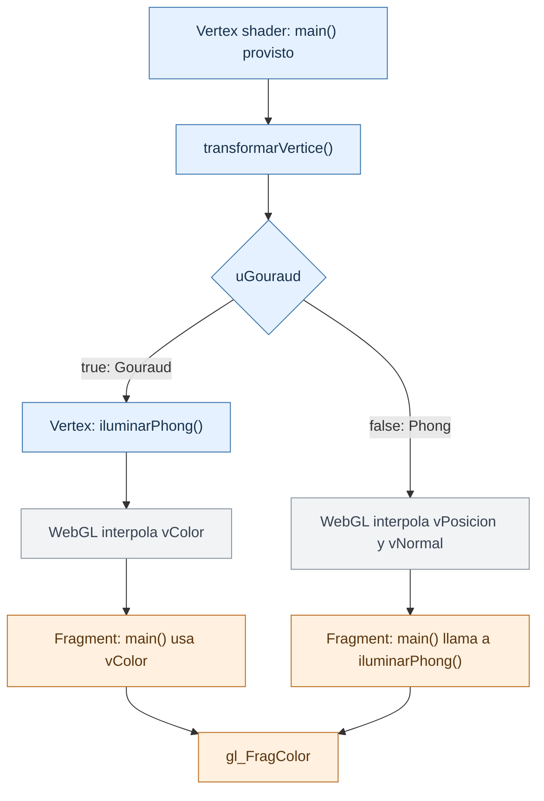

# TP 10 · Modelos de iluminación

En TP4.0 rasterizaste triángulos y resolviste qué superficie se ve en cada píxel.
Ahora vas a calcular **su color a partir de la luz, el material y la orientación
de la superficie**, escribiendo shaders en GLSL. WebGL se encarga de rasterizar,
interpolar y resolver la profundidad; las matrices y la carga de modelos están provistas.

## La idea: iluminación de Phong

El modelo suma tres contribuciones:

- **Ambiente:** un aporte constante que aproxima la luz indirecta.
- **Difusa:** depende de cuánto apunta la normal hacia la luz; disminuye al iluminar de costado.
- **Especular:** produce un reflejo brillante cuando la vista coincide con la dirección reflejada.

Para un punto `P`, usamos vectores unitarios: `N` es la normal, `L` apunta hacia
la luz y `V` hacia la cámara. Trabajamos en **espacio cámara**: la cámara está en
el origen, por lo que `V = normalize(-P)`. La luz es direccional: `L` es igual
para todos los puntos y no hay atenuación con la distancia.

Como en la diapositiva 56, **θ** es el ángulo entre `N` y `L`, y **σ** entre
la reflexión `R` y la vista `V`. Basta calcular sus cosenos con productos
escalares de vectores unitarios; no hace falta obtener los ángulos con `acos`.

`Ka`, `Kd` y `Ks` son coeficientes RGB del material; `Ia` e `I`, intensidades RGB.
Las multiplicaciones se hacen por canal. Un exponente `alpha` (α) mayor produce un
reflejo más concentrado. Si la luz queda detrás de la superficie, solo aporta el
ambiente. Usá el modelo de Phong de clase: calculá la dirección reflejada `R`
para obtener el aporte especular.

**Modelo de iluminación y sombreado son cosas distintas.** Las dos vistas usan
la misma fórmula de Phong. Gouraud la evalúa en los vértices e interpola colores;
el sombreado de Phong interpola posiciones y normales, y evalúa la fórmula en
cada fragmento. Por eso puede mostrar brillos que Gouraud pierde en una malla gruesa.

## Qué implementar

Seguí este orden en [`ejercicio.js`](ejercicio.js):

1. Implementá **`transformarVertice()`**: posiciones y normales.
2. Implementá **`iluminarPhong()`**: color del punto.
3. Implementá **`main()` del fragment shader**: color final del fragmento.

Son las tres funciones a completar. Están escritas en GLSL dentro de textos
de JavaScript. Conservá las declaraciones de ambos shaders y el `main()` del
vertex shader, marcados como **provistos**.

Los **atributos** cambian por vértice; los **uniformes** (prefijo `u`) son constantes
durante un dibujo; los **varyings** llevan datos entre shaders, interpolados por WebGL.

### 1. `transformarVertice()` — vertex shader

**Entradas:** atributos y uniformes, sin parámetros de función.

| Variable | Tipo y significado |
| --- | --- |
| `aPosicion` | `vec3`: posición del vértice en espacio objeto. |
| `aNormal` | `vec3`: normal del vértice en espacio objeto. |
| `uMV` | `mat4`: transformación de objeto a cámara. |
| `uMVP` | `mat4`: transformación de objeto al volumen canónico, en coordenadas homogéneas. |
| `uNormal` | `mat3`: transformación de normales de objeto a cámara. |

**Salidas:** escribe las siguientes variables; no devuelve un valor.

| Salida | Qué representa |
| --- | --- |
| `gl_Position` | `vec4`: posición homogénea en el volumen canónico. |
| `vPosicion` | `vec3`: posición en espacio cámara. |
| `vNormal` | `vec3`: normal unitaria en espacio cámara. |

### 2. `iluminarPhong(posicion, normal)` — modelo de iluminación

**Entradas:** dos parámetros y los uniformes de luz y material.

| Variable | Tipo y significado |
| --- | --- |
| `posicion` | `vec3`: posición del punto en espacio cámara. |
| `normal` | `vec3`: normal en espacio cámara; puede no tener longitud unitaria. |
| `uLuz` | `vec3`: dirección hacia la luz en espacio cámara. |
| `uI`, `uIa` | `vec3`: intensidades RGB de luz directa y ambiente. |
| `uKa` | `vec3`: coeficiente ambiente RGB del material. |
| `uKd` | `vec3`: coeficiente difuso RGB del material. |
| `uKs` | `vec3`: coeficiente especular RGB del material. |
| `uAlpha` | `float`: exponente especular, entre 1 y 256. |

**Salida:** devuelve un `vec3` con el color RGB del punto según el modelo de Phong.

### 3. `main()` — fragment shader

**Entradas:** varyings interpolados por WebGL y uniformes, sin parámetros de función.

| Variable | Tipo y significado |
| --- | --- |
| `vColor` | `vec3`: color interpolado entre los vértices. |
| `vPosicion` | `vec3`: posición interpolada en espacio cámara. |
| `vNormal` | `vec3`: normal interpolada en espacio cámara; puede no ser unitaria. |
| `uGouraud` | `bool`: `true` para Gouraud; `false` para Phong. |

También están disponibles los uniformes de luz y material del paso 2.

**Salida:** escribe en `gl_FragColor` un `vec4` con el color RGB del fragmento
según el sombreado seleccionado y opacidad `1.0`. No devuelve un valor.

## Cómo se arman los shaders (provisto)

`vertexShader` y `fragmentShader` contienen sus declaraciones de variables y su
`main()`. La línea `vec3 iluminarPhong(vec3 posicion, vec3 normal);` declara la
función compartida, cuyo cuerpo está en `iluminacionGLSL`.

Antes de compilar, `shaders.js` agrega la precisión numérica y concatena ese cuerpo
al final de cada shader:

```text
Código vertex   = precisión + vertexShader   + iluminacionGLSL
Código fragment = precisión + fragmentShader + iluminacionGLSL
```

El `+` une textos. Cada código resultante contiene su propia copia de
`iluminarPhong` y su `main()`. Luego `visor.js` compila ambos shaders por separado
y los enlaza en un programa WebGL. Este armado está provisto: implementás la
función de iluminación una sola vez.

En cada vista, `uGouraud` elige el **sombreado**; el modelo de iluminación siempre
es Phong. Este es el recorrido entre los shaders:



**Azul:** vertex shader. **Naranja:** fragment shader. **Gris:** interpolación de WebGL.

Referencia: material **8.0 Modelos de iluminación**, modelo de Phong (págs. 32–57),
ambiente (65), Gouraud y Phong (77–82), y transformaciones de normales (83–122).
