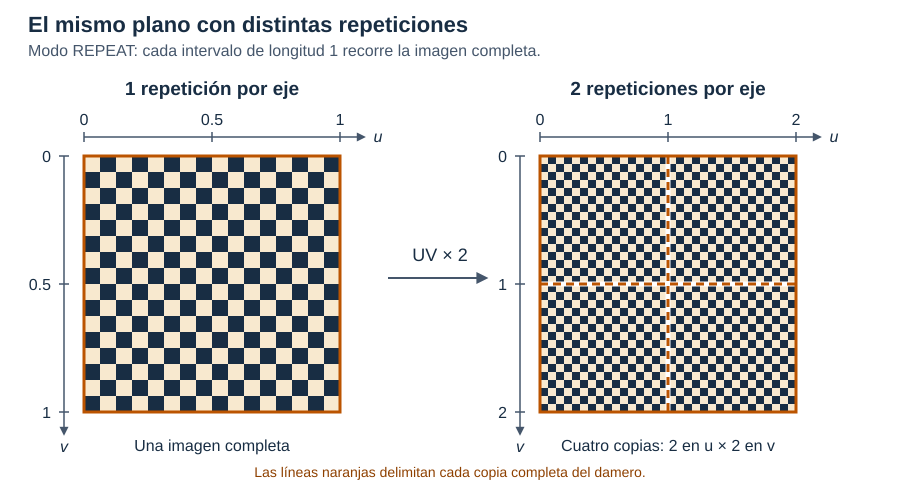
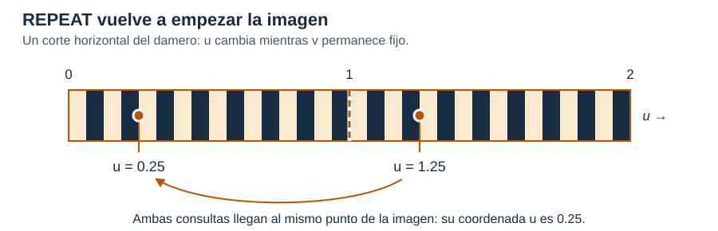
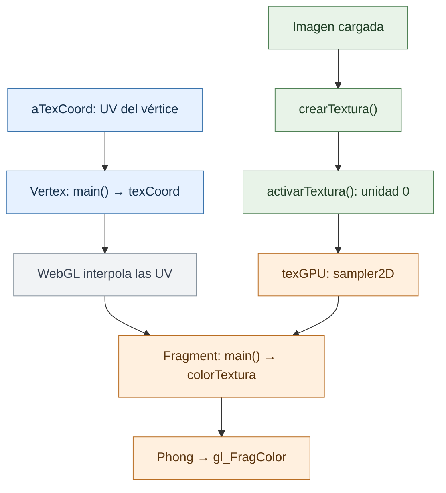

# TP 11 · Texturas

En TP10.0 iluminamos un material de color uniforme. Ahora vamos a usar una imagen
para que ese color cambie sobre la superficie, conservando la iluminación de
Phong. El trabajo consiste en cargar la imagen y conectar su información con
los shaders.

## De la imagen al fragmento

Para colocar la imagen sobre el modelo necesitamos indicar qué punto de ella
corresponde a cada vértice. Para eso usamos las coordenadas **UV**, independientes
de la posición 3D. En este TP, `(0,0)` está arriba a la izquierda: `u` crece hacia
la derecha y `v` hacia abajo.

El vertex shader pasa esas coordenadas como un `varying vec2`. Durante el
rasterizado, WebGL las interpola para cada fragmento. Así, el fragment shader
puede consultar la imagen con `texture2D` y obtener el color RGBA (`vec4`) que
corresponde a ese punto de la superficie.

Para que esa consulta funcione, primero cargamos la imagen en un **objeto de
textura** de la GPU y lo vinculamos a una **unidad de textura**. Usaremos la unidad
**0**: el `sampler2D texGPU` recibe ese número para saber dónde consultar.

El visor permite comparar el material de base blanca, a la izquierda, con el
texturado, a la derecha. La imagen colorea los aportes ambiente y difuso (`Ka` y
`Kd`), de modo que también se vea en las zonas sin luz directa. El brillo
especular conserva `Ks`.

## Repetición y filtrado

### Coordenadas fuera de la imagen

Probá elegir **Plano**, **Damero** y **Repeticiones = 2**. Multiplicar unas
UV por 2 multiplica sus dos componentes, por ejemplo: `(0.25, 0.75)` pasa a `(0.5, 1.5)`.
Así, las coordenadas que recorrían `[0,1]` ahora recorren `[0,2]` sobre el mismo
plano. WebGL interpola esas coordenadas ampliadas para cada fragmento.

Al consultar la textura, el modo **Repetir** (`REPEAT`) toma la parte fraccionaria
de cada coordenada: `u = 1.25` consulta el mismo lugar que `u = 0.25`. En la primera
mitad del plano, la nueva `u` recorre de 0 a 1 y muestra la imagen completa; en la
segunda recorre de 1 a 2 y vuelve a mostrarla. Como lo mismo sucede con `v`, aparece
un mosaico de 2×2 imágenes. Con un valor entero N, aparecen N copias por eje.

La multiplicación amplía el rango de las UV; la repetición ocurre después, al
consultar la imagen. En este TP las texturas siempre usan `REPEAT` en ambos ejes.

### Interpolación del color

Las UV interpoladas pueden caer entre los píxeles de la imagen, llamados
**texeles**. El filtro determina cómo obtener un color en ese punto. Para verlo,
elegí **Damero** y acercá la cámara: **Vecino más cercano** (`NEAREST`) toma un solo
texel y deja ver bloques, mientras que **Bilineal** (`LINEAR`) interpola los cuatro
vecinos según la distancia y suaviza las transiciones.

Al alejar la cámara, muchos texeles pueden quedar dentro de un único píxel de
pantalla. Los **mipmaps** ayudan en esa situación: son copias más pequeñas de la
imagen, por ejemplo 512×512 → 256×256 → 128×128. El filtro **Trilineal**
(`LINEAR_MIPMAP_LINEAR`) hace una consulta bilineal en dos niveles de mipmap y
mezcla sus resultados. Probá alejarte y aumentar las repeticiones del damero:
deberías ver menos parpadeo en los detalles al mover la cámara. Al ampliar,
esta opción usa bilineal.

La selección del filtro llega a `configurarMuestreo()`, en `visor.js`, que
configura la textura con `gl.texParameteri`. `TEXTURE_MIN_FILTER` elige el filtro
al reducir la imagen y `TEXTURE_MAG_FILTER` al ampliarla. Estos valores quedan
asociados a la textura: cada consulta con `texture2D` los aplica automáticamente,
por lo que cambiar el filtro no requiere modificar el shader.

## Qué implementar

El recorrido se divide en cuatro pasos dentro de [`ejercicio.js`](ejercicio.js):
los dos primeros conectan la imagen con WebGL y los otros dos llevan sus colores
al fragmento.

### 1. `crearTextura(gl, img)` — JavaScript

Recibe el contexto WebGL `gl` y una imagen o canvas `img` ya cargado, con ancho y
alto potencia de 2. Debe devolver un `WebGLTexture` con la imagen en su orientación
original y sus niveles de mipmap.

### 2. `activarTextura(gl, programa, textura)` — JavaScript

Recibe `gl`, el programa WebGL enlazado y la textura creada en el paso anterior.
Al terminar, la unidad 0 debe estar activa, la textura vinculada a ella y `texGPU`
asociado a esa unidad en el programa. La función no devuelve un valor.

### 3. Coordenadas de textura en `main()` — vertex shader

El shader recibe las UV del vértice en `aTexCoord` (`vec2`) y la cantidad de
repeticiones en `uRepeticiones` (`float`). Debe dejar en `texCoord` (`varying vec2`)
las UV con las repeticiones aplicadas en ambos ejes.

### 4. Consulta de textura en `main()` — fragment shader

El shader recibe el sampler `texGPU` (`sampler2D`) y las UV interpoladas en
`texCoord` (`vec2`). Cuando `uUsarTextura` está activo, el bloque debe dejar en
`colorTextura` (`vec3`) el RGB leído de la imagen.

## Recorrido

La imagen y las UV llegan por caminos distintos y se encuentran en el fragment shader:

**Verde:** JavaScript. **Azul:** vertex shader. **Naranja:** fragment shader.
**Gris:** interpolación de WebGL.

## Modelos y visor

Podés usar los modelos del visor o cargar un OBJ. Al leerlo, sus coordenadas `vt`
se adaptan al origen superior cambiando `v` por `1-v`; si no tiene UV, se muestra
solo con iluminación. Las imágenes se ajustan a potencias de 2, hasta 2048 por
eje, para permitir repetición y mipmaps en WebGL 1.

Las declaraciones GLSL están en cada shader. Al armarlos, `shaders.js` agrega la
precisión numérica y el cuerpo de la función de iluminación al fragment shader.
Luego `visor.js` compila, enlaza y envía los datos necesarios para dibujar.

Referencia: **9.0 Texturas**, coordenadas e interpolación (págs. 15–26), filtrado
y mipmaps (27–62), y carga, unidades y samplers en WebGL (63–79).
