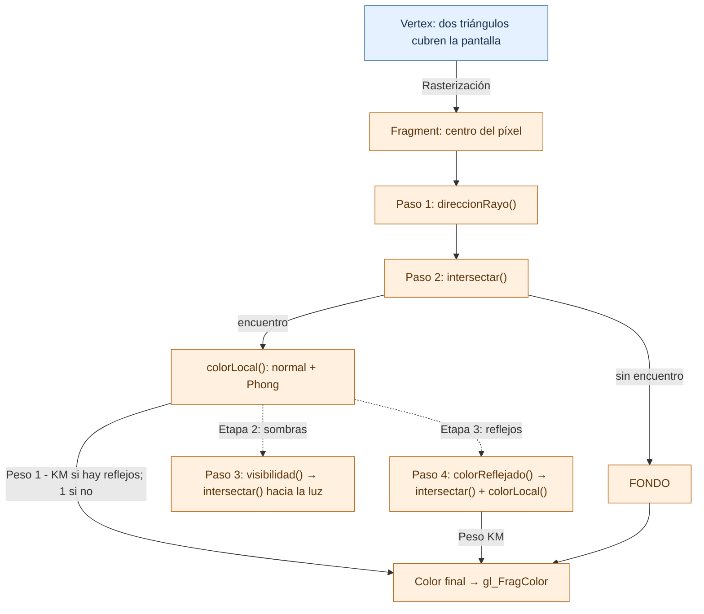

# TP 12 · Ray tracing

Desde la cámara lanzamos un rayo por píxel, buscamos la primera superficie que
encuentra y la iluminamos con Phong: **generar el rayo → encontrar la intersección
→ calcular el color**. La escena contiene un plano damero, esferas y cubos definidos
mediante funciones de distancia con signo (SDF).

Completá los cuatro bloques de `shaders/ejercicio.frag` marcados con `>>> COMPLETAR`,
siguiendo sus pasos internos: **render básico → sombras → reflejos**. Trabajamos en
**espacio mundo**, con direcciones unitarias.

`ejercicio.js` selecciona los archivos `.vert` y `.frag`, que podés editar con GLSL
Lint. Abrí `index.html` desde un servidor local, como Live Server, para poder cargarlos.

## Etapa 1 · Render básico

Dejá **Sombras** y **Reflejos** desactivados y completá los pasos 1 y 2.

### Paso 1 · `direccionRayo(pixel)`

Recibe el centro del píxel (`vec2`) y devuelve su dirección unitaria (`vec3`).
Ubicá el punto correspondiente en el plano imagen, una unidad delante de `uOjo`:
U apunta a la derecha, V hacia arriba y W hacia atrás. `uSemialto` y la relación
ancho/alto determinan el tamaño del plano. Restá `uOjo` a ese punto y normalizá
el vector; el origen del rayo sigue siendo `uOjo`.

### Paso 2 · `intersectar(origen, direccion, limite)`

Recibe el origen, una dirección unitaria y la distancia máxima a recorrer.
Devuelve la distancia `t` al primer encuentro, o `-1` si no lo encuentra.

Sobre el rayo `r(t) = origen + t * direccion`, `t` mide lo recorrido.
`distanciaEscena(r(t))` mide la distancia a la superficie más cercana, aunque esté
a un costado del rayo: podemos avanzar esa cantidad sin atravesar ningún objeto.
Repetir este proceso se llama **sphere tracing**. La SDF es positiva afuera,
cero sobre la superficie y negativa adentro; los rayos comienzan afuera.

```text
empezar en t = 0
repetir hasta MAX_PASOS:
    medir la distancia a la escena en r(t)
    si es menor que EPSILON, devolver t
    avanzar t esa distancia
    si t alcanza el límite del rayo, terminar la búsqueda
si no hubo encuentro, devolver -1
```

`EPSILON` es la tolerancia del encuentro. Con ambos pasos completos, `main` ubica
el punto y `colorLocal` calcula Phong. Si el rayo no encuentra nada, vemos `FONDO`.

## Etapa 2 · Agregar sombras

### Paso 3 · `visibilidad(p, normal)`

Recibe un punto y su normal exterior unitaria. Devuelve `1` si llega la luz o `0`
si está tapada. Desplazá el origen un poco hacia afuera para evitar detectar la
propia superficie y usá `intersectar` hacia `uPosLuz`, limitado a la distancia
hasta ella: un objeto detrás de la luz no produce sombra.

Activá **Sombras**, todavía sin reflejos. En los puntos tapados se conserva el
aporte ambiente y se quitan los aportes difuso y especular.

## Etapa 3 · Agregar reflejos

### Paso 4 · `colorReflejado(p, direccion)`

Recibe un punto y la dirección unitaria del rayo que llegó a él. Devuelve el
color RGB del siguiente encuentro, o `FONDO` si no hay otro encuentro.

Para reflejar la dirección, conservá su componente tangente e invertí la componente
normal. Separá el origen de la superficie, buscá el encuentro con `intersectar`
y obtené su color con `colorLocal`. Seguimos **un solo rebote**.

Activá **Reflejos**. `main` combina 65% del color local y 35% del reflejado
(`KM = 0.35`); esta función devuelve el color sin aplicar ese peso. Las sombras
también pueden afectar al objeto reflejado.

## Cómo se conectan los shaders

`visor.js` envía cuatro esquinas que forman dos triángulos y cubren el canvas.
`pantalla.vert` las recibe en el volumen canónico, sin necesitar MVP. Al rasterizarlos,
el fragment shader usa `gl_FragCoord` para generar un rayo por píxel y consultar
las SDF. La cámara orienta los rayos; el rectángulo siempre cubre la pantalla.



Azul: vertex shader. Naranja: fragment shader. Las SDF, el damero, las normales
y Phong están al final del fragment shader.

Referencias: **10.0 Algoritmos de Rendering**, rayos e intersecciones (págs. 27,
45–67), sombras y precisión (80–85), reflejos (91–96). Para explorar las primitivas,
consultá el catálogo de [SDF de Inigo Quilez](https://iquilezles.org/articles/distfunctions/)
y su explicación de [ray marching con campos de distancia](https://iquilezles.org/articles/raymarchingdf/).
